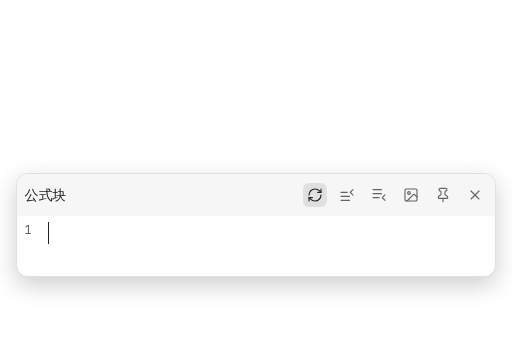
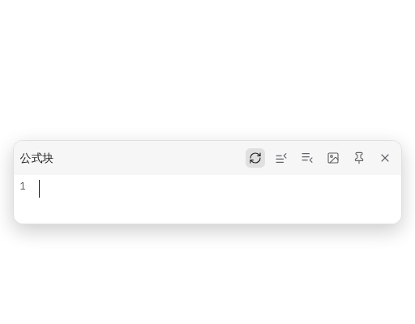

[中文](https://github.com/JeffeyChou/siyuan-latex-suite/blob/main/README.zh-CN.md)

# LaTeX Suite

The main features of [obsidian-latex-suite](https://github.com/artisticat1/obsidian-latex-suite), in SiYuan's formula editor popup (math blocks and inline math).

## Features



- **Snippets** expand as you type: `sr` → `^{2}`, `alpha` → `\alpha`, `->` → `\to`, `x2` → `x_{2}`, `RR` → `\mathbb{R}`, `pmat` → a `pmatrix` environment. Snippets without the A option (`\sum`, `\int`, `par`) expand on Tab.
- **Tabstops**: `sum` then Tab gives `\sum_{i=1}^{N}`; Tab and Shift+Tab move between `i`, `1` and `N`. Repeated placeholders are synced when you leave them.


- **Auto-fraction**: `x/` → `\frac{x}{}`, `(a+b)/` → `\frac{a+b}{}`; with text selected, `/` makes it the numerator.
- **Visual snippets**: select text and type `U` `O` `B` `C` `K` `S` `(` `[` `{` for underbrace, overbrace, underset, cancel, bcancel, sqrt and brackets.


- **Tabout**: Tab jumps past the next closing bracket, Shift+Tab before the previous opening one; at the end, Tab closes the popup.
- **Matrix shortcuts**: in `pmatrix`, `cases`, `aligned` and similar environments, Tab inserts `&` and Enter a `\\` line break.



- **Auto-enlarge brackets**: brackets around `\sum`, `\int`, `\frac` and the like become `\left( … \right)`.
- **Colored and matched brackets**: brackets are colored by depth, unmatched ones are red, the pair at the cursor is highlighted.


Snippets, variables and every feature switch are in the plugin settings. The snippet format is obsidian-latex-suite's, so its snippet files can be pasted in.

## Notes

- Only the formula popup is affected, not the text or code blocks.
- Snippets do not fire while an IME is composing; switch to an English layout inside formulas.
- The snippet definition is JavaScript that runs locally; only paste snippets you trust.
- The default snippets are adapted from obsidian-latex-suite (MIT), without its text-mode ones; KaTeX has no `\cancelto`, so `K` gives `\bcancel`.

## Development

```bash
pnpm i
pnpm test        # snippet and editing logic, in Node
pnpm run build   # writes dist/ and package.zip
```
