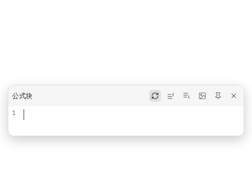
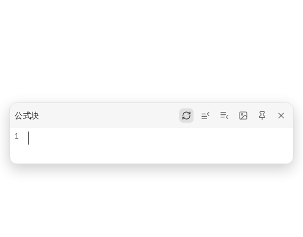

[English](https://github.com/JeffeyChou/siyuan-latex-suite/blob/main/README.md)

# LaTeX Suite 公式助手

把 [obsidian-latex-suite](https://github.com/artisticat1/obsidian-latex-suite) 的主要功能搬到思源的公式编辑弹窗（公式块和行内公式）里。

## 功能



- **片段**：边打边展开，如 `sr` → `^{2}`、`alpha` → `\alpha`、`->` → `\to`、`x2` → `x_{2}`、`RR` → `\mathbb{R}`、`pmat` → `pmatrix` 环境。不带 A 选项的片段（如 `\sum`、`\int`、`par`）按 Tab 展开。
- **Tab 占位符**：`sum` 再按 Tab 得到 `\sum_{i=1}^{N}`，Tab / Shift+Tab 在 `i`、`1`、`N` 之间跳转；重复的占位符在离开时同步。


- **自动分式**：`x/` → `\frac{x}{}`，`(a+b)/` → `\frac{a+b}{}`；选中文字后按 `/` 把选中内容作分子。
- **可视片段**：选中文字后输入 `U` `O` `B` `C` `K` `S` `(` `[` `{`，分别得到 underbrace、overbrace、underset、cancel、bcancel、sqrt 和加括号。


- **Tab 跳出**：Tab 跳到下一个右括号之后，Shift+Tab 跳到上一个左括号之前；已在末尾时 Tab 关闭弹窗。
- **矩阵快捷键**：在 `pmatrix`、`cases`、`aligned` 等环境里 Tab 插入 `&`，Enter 插入 `\\` 换行。



- **自动放大括号**：括号里出现 `\sum`、`\int`、`\frac` 等时自动改成 `\left( … \right)`。
- **彩色括号与匹配高亮**：括号按深度着色，不配对的标红，光标处的一对括号高亮。
- **正文里新建公式**：在段落里输入 `mk` 新建行内公式，在空段落里单独输入 `dm` 新建公式块，编辑弹窗随即打开。触发词可在设置里修改或关闭。
- **片段速查**：列出当前生效的全部片段，可搜索，可按自动、Tab、可视、正则筛选。点公式弹窗标题栏的 ? 按钮、在命令面板搜「片段速查」或在设置里打开。


片段、变量和各项开关都在插件设置里修改，片段格式与 obsidian-latex-suite 相同，可以直接粘贴它的片段文件。

## 说明

- 除 `mk` / `dm` 外只在公式编辑弹窗里起作用；代码、链接、标签里不会触发。
- 使用中文输入法时片段不会触发，请在公式里切到英文。
- 片段定义是 JavaScript 代码，会在本地执行，请只粘贴可信的内容。
- 默认片段改编自 obsidian-latex-suite（MIT），去掉了只用于正文的片段；KaTeX 不支持 `\cancelto`，`K` 改为 `\bcancel`。

## 开发

```bash
pnpm i
pnpm test        # 在 Node 里测试片段与编辑逻辑
pnpm run build   # 生成 dist/ 和 package.zip
```
